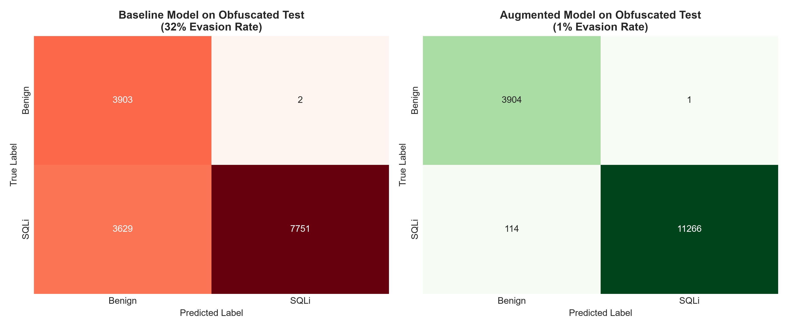

# sqli-detection-ml
AI-based detection of SQL injection attacks using machine learning (Global Student Forum 2026)

# AI-Based Detection of SQL Injection Attacks using Machine Learning

Code and experiments for the research paper submitted to the International Student Scientific-Innovation Conference **"GLOBAL STUDENT FORUM – 2026"**.

---

## 📌 Problem & Motivation
Traditional Machine Learning models trained on standard SQL logs achieve high accuracy on simple payloads but fail drastically against **obfuscated attack vectors (WAF Evasion techniques)**. Obfuscation techniques (e.g., inline comments `/**/`, random casing, character encoding) alter payload signatures without changing SQL execution logic, leading to critical False Negative rates in production environments.

---

## 🎯 Research Objective
Evaluate the impact of **syntax-aware data augmentation** on the robustness of ML-based SQL injection detection models when exposed to heavily obfuscated payloads.

---

## 📊 Dataset & Preprocessing
The project evaluates models on distinct clean, augmented, and obfuscated splits:

* **Clean Train (`train_clean.csv`)**: 24,804 samples (15,622 normal, 9,182 SQLi)
* **Augmented Train (`train_augmented.csv`)**: 26,999 samples (15,622 normal, 11,377 SQLi)
* **Clean Test (`test_clean.csv`)**: 6,181 samples
* **Obfuscated Test (`test_obfuscated.csv`)**: 15,285 samples

*Data deduplication and whitespace normalization were applied using `src/dedupe.py`.*

---

## 🚀 Model Architecture & Feature Extraction
* **Feature Extractor**: Character-level TF-IDF Vectorizer (`ngram_range=(2, 5)`, `max_features=10,000`).
* **Classifier**: Logistic Regression (`max_iter=1000`).

---

## 📈 Empirical Results

| Model / Strategy | Test Set | Accuracy | Precision (SQLi) | Recall (SQLi) | F1-Score (SQLi) | Evasion Rate |
|---|---|---|---|---|---|---|
| **Baseline** (Standard Train) | `test_clean` | 0.99 | 1.00 | 0.99 | 0.99 | 1% |
| **Baseline** (Standard Train) | `test_obfuscated` | 0.76 | 1.00 | 0.68 | 0.81 | **32%** |
| **Augmented (Proposed)** | `test_clean` | **0.99** | **1.00** | **0.99** | **0.99** | 1% |
| **Augmented (Proposed)** | `test_obfuscated` | **0.99** | **1.00** | **0.99** | **0.99** | **1%** |

### Key Finding
Data augmentation improved the model's Recall on obfuscated SQL injections from **68% to 99%**[cite: 5, 6], reducing False Negatives from **3,629 to 114**[cite: 8] (a **31x reduction in evasion rate**)[cite: 8].



---

## 🛠️ How to Reproduce

```bash
# 1. Install dependencies
pip install -r requirements.txt

# 2. Run deduplication script
python src/dedupe.py data/train_clean.csv data/train_clean_dedup.csv

# 3. Launch Jupyter Notebook
python -m notebook
